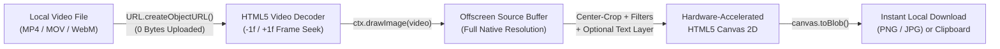

<div align="center">


# VideoThumbnail — Client-Side Video Thumbnail Maker

**Extract high-resolution frames from any MP4, MOV, or WebM video and design YouTube thumbnails directly in your browser.**  
*100% Free • Zero Server Uploads • Zero Watermarks • Offline-Ready PWA*

[](https://videothumbnail.github.io/)
[](https://astro.build/)
[](https://react.dev/)
[](https://tailwindcss.com/)
[](LICENSE)
[](https://kisharadilshan.gumroad.com/coffee)

[**Launch Live Studio**](https://videothumbnail.github.io/) · [**How to Use Guide**](https://videothumbnail.github.io/how-to-use/) · [**Hire the Developer**](https://videothumbnail.github.io/hire-me/) · [**Report an Issue**](https://github.com/videothumbnail/videothumbnail.github.io/issues)

</div>

---

## Overview

**VideoThumbnail** ([https://videothumbnail.github.io/](https://videothumbnail.github.io/)) is a privacy-first, zero-server web application built for YouTube creators, video editors, and social media teams. Unlike traditional online thumbnail generators that require uploading multi-gigabyte video files to remote cloud servers, VideoThumbnail executes **100% locally inside the user's browser** using native HTML5 `<video>` frame seeking and hardware-accelerated HTML5 `<canvas>` 2D compositing.

Even large 4K raw recordings open instantaneously, unreleased footage never leaves the local device, and the entire studio continues working **100% offline** once installed via **Add to Home Screen** (PWA).

---

## Key Capabilities

### 1. Precision Frame Extraction (`-1f / +1f`)
- **Zero-Upload Local File Decoding:** Supports `.mp4`, `.mov`, and `.webm` containers directly from disk via `URL.createObjectURL()`.
- **Frame-Accurate Scrubbing:** Step backward or forward by a single frame (`-1f` / `+1f` at `1/30s` precision) or by full seconds (`-1s` / `+1s`) to eliminate motion blur and capture expressive faces or action peaks.
- **Auto-Generated Filmstrip Quick Picks:** Automatically samples 6 evenly spaced preview frames across the video timeline using a background video clone so users can jump and capture in a single click.
- **Instant Offline Sample Mode:** Includes an embedded procedural multi-scene HD sample generator so first-time visitors can test frame scrubbing, aspect ratio cropping, and text overlays immediately with zero network downloads.

### 2. Multi-Platform Aspect Ratio & Resolution Engine
- **`16:9` YouTube Standard (`1280×720`):** Official Google-recommended HD resolution for YouTube video thumbnails.
- **`9:16` Vertical Cover (`1080×1920`):** Automatic center-cropped vertical canvas for YouTube Shorts, TikTok, and Instagram Reels covers.
- **`1:1` Square (`1080×1080`):** Balanced square export for community posts, feeds, and podcasts.

### 3. Minimalist Progressive-Disclosure Studio
- **Clean, Uncluttered Default Workspace:** Newly loaded videos open with zero pre-added text and `100%` natural color fidelity so the preview matches the source video frame immediately.
- **Collapsible Text Overlay Studio:** Expands on demand to add bold headlines and optional badge subtext with 4 high-CTR presets (**Bold Outline**, **Pill Banner**, **Neon Pop**, **Clean Shadow**), curated color swatches, font scaling, quick snap positions (`Top`, `Center`, `Bottom`), and direct pointer/touch dragging on the canvas.
- **Collapsible Visual Pop & Color Tuning:** Expands on demand for one-click **Auto Vivid Pop** or manual **Brightness**, **Contrast**, and **Vibrance / Saturation** adjustments.

### 4. Instant Local Export
- **Lossless `PNG`:** Full-resolution uncompressed bitmap export.
- **YouTube-Ready `JPG (< 2 MB)`:** High-quality `0.92` JPEG encoding engineered to stay cleanly below YouTube Studio's `2 MB` thumbnail upload limit.
- **One-Click Clipboard Copy:** Copy the rendered thumbnail directly to the system clipboard via the `ClipboardItem` API.

---

## Client-Side Processing Architecture



| Layer | Implementation |
| :--- | :--- |
| **Static Shell** | **Astro 5** (`output: 'static'`) delivering zero-JavaScript HTML landmarks outside the interactive studio island |
| **Interactive Studio Island** | **React 19 + TypeScript** hydrated with `client:load` in [`src/components/ThumbnailMakerIsland.tsx`](src/components/ThumbnailMakerIsland.tsx) |
| **Styling & Themes** | **Tailwind CSS** + CSS Custom Properties for **Clean Light** (default) and **Dark** modes with an inline anti-FOUC initialization script |
| **Offline PWA Engine** | [`public/manifest.webmanifest`](public/manifest.webmanifest) + cache-first Service Worker ([`public/sw.js`](public/sw.js)) with native `beforeinstallprompt` and iOS Safari installation guide |
| **CI/CD Deployment** | Automated GitHub Pages pipeline via [`.github/workflows/deploy.yml`](.github/workflows/deploy.yml) |

---

## Brand & Accessible Color System (WCAG AA+)

All interactive controls, inputs, and sage-green buttons enforce a minimum **`>= 4.5:1` WCAG AA contrast ratio** using `#1D2416` dark ink on `#C5D89D` and `#F6F0D7` surfaces.

| Token | Clean Light Mode (Default) | Dark Mode (`.dark`) | Purpose |
| :--- | :--- | :--- | :--- |
| `--bg-page` | `#FAF8EE` | `#141811` | Primary page background |
| `--bg-card` | `#FFFFFF` | `#1D2318` | Studio container & card surface |
| `--bg-subtle` | `#F6F0D7` (*Warm Cream*) | `#272F21` | Secondary panels & controls |
| `--accent-primary` | `#C5D89D` (*Soft Sage*) | `#C5D89D` | Primary action buttons & active states |
| `--accent-hover` | `#9CAB84` (*Muted Olive*) | `#9CAB84` | Button hover elevation state |
| `--accent-strong` | `#89986D` (*Deep Moss*) | `#89986D` | Focus rings & active borders |
| `--text-primary` | `#1D2416` | `#F6F0D7` | Primary headings & body copy |
| `--text-secondary` | `#4A543E` | `#CBD4B8` | Supporting labels & captions |
| `--border-color` | `#DCE3C8` | `#35402D` | Hairline dividers & card borders |

---

## 8-Language Internationalization (i18n)

All 24 static pages are pre-rendered across 8 languages from [`src/i18n/translations.ts`](src/i18n/translations.ts) with symmetric `<link rel="alternate" hreflang="...">` tags and `hreflang="x-default"` in both HTML `<head>` and [`/sitemap.xml`](https://videothumbnail.github.io/sitemap.xml).

| Locale | Language | Home Studio | How to Use Guide | Hire Me |
| :---: | :--- | :--- | :--- | :--- |
| `en` | **English** | [`/`](https://videothumbnail.github.io/) | [`/how-to-use/`](https://videothumbnail.github.io/how-to-use/) | [`/hire-me/`](https://videothumbnail.github.io/hire-me/) |
| `es` | **Español** | [`/es/`](https://videothumbnail.github.io/es/) | [`/es/how-to-use/`](https://videothumbnail.github.io/es/how-to-use/) | [`/es/hire-me/`](https://videothumbnail.github.io/es/hire-me/) |
| `pt` | **Português** | [`/pt/`](https://videothumbnail.github.io/pt/) | [`/pt/how-to-use/`](https://videothumbnail.github.io/pt/how-to-use/) | [`/pt/hire-me/`](https://videothumbnail.github.io/pt/hire-me/) |
| `de` | **Deutsch** | [`/de/`](https://videothumbnail.github.io/de/) | [`/de/how-to-use/`](https://videothumbnail.github.io/de/how-to-use/) | [`/de/hire-me/`](https://videothumbnail.github.io/de/hire-me/) |
| `fr` | **Français** | [`/fr/`](https://videothumbnail.github.io/fr/) | [`/fr/how-to-use/`](https://videothumbnail.github.io/fr/how-to-use/) | [`/fr/hire-me/`](https://videothumbnail.github.io/fr/hire-me/) |
| `ja` | **日本語** | [`/ja/`](https://videothumbnail.github.io/ja/) | [`/ja/how-to-use/`](https://videothumbnail.github.io/ja/how-to-use/) | [`/ja/hire-me/`](https://videothumbnail.github.io/ja/hire-me/) |
| `zh` | **简体中文** | [`/zh/`](https://videothumbnail.github.io/zh/) | [`/zh/how-to-use/`](https://videothumbnail.github.io/zh/how-to-use/) | [`/zh/hire-me/`](https://videothumbnail.github.io/zh/hire-me/) |
| `ru` | **Русский** | [`/ru/`](https://videothumbnail.github.io/ru/) | [`/ru/how-to-use/`](https://videothumbnail.github.io/ru/how-to-use/) | [`/ru/hire-me/`](https://videothumbnail.github.io/ru/hire-me/) |

---

## Technical SEO & Structured Data Compliance

- **Strict Metadata Standards:** All 24 localized pages enforce `<title>` lengths between **50–60 characters** and `<meta name="description">` lengths between **130–155 characters**.
- **Open Graph & Twitter Cards:** Explicit `og:type="website"`, `og:site_name="VideoThumbnail"`, `og:url`, `og:title`, `og:description`, `og:locale`, and static `1200×630` [`public/og-image.png`](public/og-image.png) paired with `twitter:card="summary_large_image"`.
- **JSON-LD Schema Markup (Zero Fake Ratings):**
  - **Home (`/`):** `WebApplication` (`$0` free offer, local browser requirements, feature list) + `FAQPage` (mirroring the 4 visible Q&As below the fold).
  - **How to Use (`/how-to-use/`):** `BreadcrumbList` + `HowTo` (4 structured steps).
  - **Hire Me (`/hire-me/`):** `BreadcrumbList` + `Person` (Kishara Dilshan profile & specialties).
- **Flat GSC-Ready XML Sitemap:** [`src/pages/sitemap.xml.ts`](src/pages/sitemap.xml.ts) generates a direct, flat `<urlset>` at `https://videothumbnail.github.io/sitemap.xml` referenced in [`public/robots.txt`](public/robots.txt).

---

## Project Structure

```text
videothumbnail.github.io/
├── .github/
│   ├── workflows/
│   │   └── deploy.yml                # Automated GitHub Pages CI/CD workflow
│   └── FUNDING.yml                   # Developer sponsorship link
├── public/
│   ├── favicon.svg                   # Crisp vector brand icon
│   ├── icon-192.png                  # PWA maskable app icon (192x192)
│   ├── icon-512.png                  # PWA maskable app icon (512x512)
│   ├── manifest.webmanifest          # Standalone offline PWA manifest
│   ├── og-image.png                  # Static 1200x630 Open Graph social card
│   ├── robots.txt                    # Crawler directives & Sitemap pointer
│   └── sw.js                         # Cache-first offline Service Worker
├── src/
│   ├── components/
│   │   ├── pages/
│   │   │   ├── HireMePage.astro      # Localized Hire Me template + Person JSON-LD
│   │   │   ├── HomePage.astro        # Localized Home template + WebApp/FAQ JSON-LD
│   │   │   └── HowToUsePage.astro    # Localized How to Use template + HowTo JSON-LD
│   │   ├── Breadcrumbs.astro         # Subpage semantic breadcrumb nav + JSON-LD
│   │   ├── Footer.astro              # Semantic footer with locale links
│   │   ├── Navbar.astro              # Minimal icon-only action bar + toggle menu
│   │   └── ThumbnailMakerIsland.tsx  # React 19 interactive video frame & canvas studio
│   ├── i18n/
│   │   └── translations.ts           # Complete 8-language translation dictionary
│   ├── layouts/
│   │   └── BaseLayout.astro          # Head metadata, anti-FOUC theme, GTM/GA4, hreflang
│   ├── pages/
│   │   ├── [lang]/
│   │   │   ├── hire-me.astro         # Localized /es/, /pt/, /de/, /fr/, /ja/, /zh/, /ru/
│   │   │   ├── how-to-use.astro
│   │   │   └── index.astro
│   │   ├── hire-me.astro             # English /hire-me/
│   │   ├── how-to-use.astro          # English /how-to-use/
│   │   ├── index.astro               # English /
│   │   └── sitemap.xml.ts            # Flat XML <urlset> generator endpoint
│   └── styles/
│       └── global.css                # Light/Dark CSS custom properties & slider styles
├── astro.config.mjs                  # Astro 5 static configuration
├── package.json
├── tailwind.config.mjs               # Brand color tokens & spring transitions
├── tsconfig.json
└── LICENSE                           # MIT License (Copyright 2026 Kishara Dilshan)
```

---

## Getting Started (Local Development)

### Prerequisites

- **Node.js** `>= 20.0.0`
- **npm** `>= 10.0.0`

### Installation & Commands

```bash
# 1. Clone the repository
git clone https://github.com/videothumbnail/videothumbnail.github.io.git
cd videothumbnail.github.io

# 2. Install dependencies
npm install

# 3. Start the Astro development server with hot reload (http://localhost:4321)
npm run dev

# 4. Build the static production bundle into ./dist
npm run build

# 5. Preview the production build locally
npm run preview
```

---

## Deployment (GitHub Pages)

1. Push commits to the `main` branch.
2. In your GitHub repository settings, navigate to **Settings → Pages** and set **Build and deployment → Source** to **GitHub Actions**.
3. The workflow in [`.github/workflows/deploy.yml`](.github/workflows/deploy.yml) automatically builds the Astro static bundle and deploys it to `https://videothumbnail.github.io/`.

---

## Author & Freelance Inquiries

Built and maintained by **Kishara Dilshan** — Full-Stack Web & WebAssembly (WASM) Developer specializing in ultra-fast Astro/React/Next.js web applications, privacy-first browser media tools, and technical SEO.

- **Hire Me for Custom Projects:** [https://videothumbnail.github.io/hire-me/](https://videothumbnail.github.io/hire-me/)
- **Direct Email:** [`kisharadilshan007@gmail.com`](mailto:kisharadilshan007@gmail.com)
- **Support the Developer:** [Buy Me a Coffee on Gumroad](https://kisharadilshan.gumroad.com/coffee)

---

## License

Distributed under the **MIT License**. See [`LICENSE`](LICENSE) for full details.
